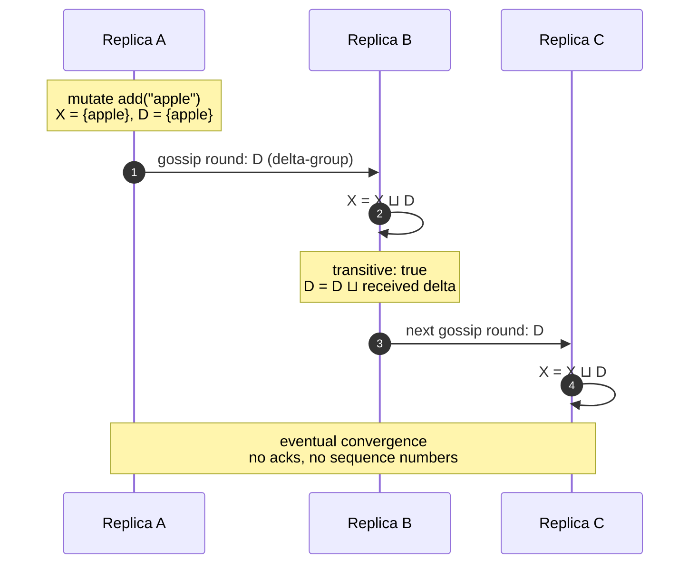
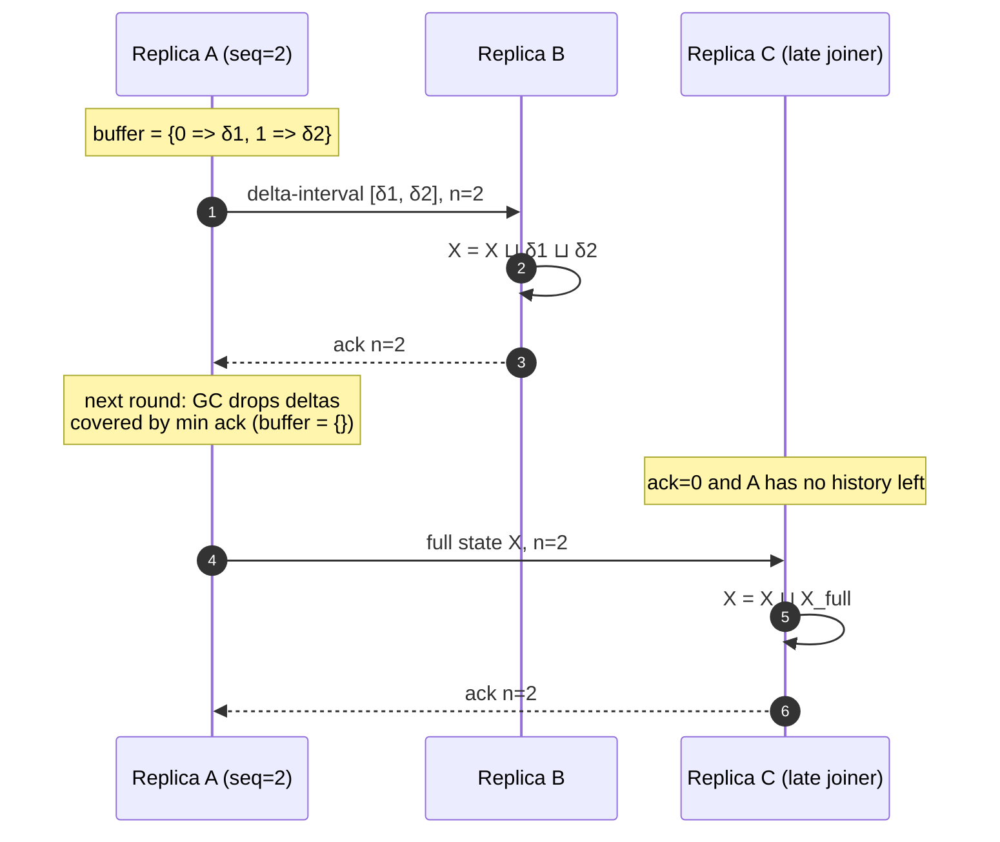

# GeCrdt

Reference implementations of state-based CRDTs in Elixir that offer deltas for
all mutations, inspired by the C++ version
[CBaquero/delta-enabled-crdts](https://github.com/CBaquero/delta-enabled-crdts/) and implemented following [Delta State Replicated Data Types](https://doi.org/10.1016/j.jpdc.2017.08.003.).

> I found really useful the readme inside the [CBaquero/delta-enabled-crdts](https://github.com/CBaquero/delta-enabled-crdts/) repository. So this one is heavily inspired by it. 

## Content

- [GeCrdt](#gecrdt)
  - [Content](#content)
  - [Datatypes](#datatypes)
  - [Simple Example](#simple-example)
  - [Example with delta mutations](#example-with-delta-mutations)
  - [Datatype Example Catalog](#datatype-example-catalog)
    - [GSet](#gset)
    - [TwoPSet](#twopset)
    - [GCounter](#gcounter)
    - [PNCounter](#pncounter)
    - [LexCounter](#lexcounter)
    - [DotKernel](#dotkernel)
    - [AWORSet](#aworset)
    - [RWSet](#rwset)
    - [MVReg](#mvreg)
    - [EWFlag](#ewflag)
    - [ORMap](#ormap)
    - [AWLWWSet](#awlwwset)
  - [Anti-entropy and replication](#anti-entropy-and-replication)
    - [Basic anti-entropy](#basic-anti-entropy)
    - [Causal anti-entropy](#causal-anti-entropy)
    - [Choosing an implementation](#choosing-an-implementation)
  - [Installation](#installation)
  - [Disclaimer](#disclaimer)

## Datatypes

Current datatypes are:

  * `GeCrdt.Types.GSet`: A grow-only set.
  * `GeCrdt.Types.TwoPSet`: A two-phase set that supports removing an element for ever.
  * `GeCrdt.Types.GCounter`: A grow-only counter.
  * `GeCrdt.Types.PNCounter`: A counter supporting increment and decrement.
  * `GeCrdt.Types.LexCounter`: A counter supporting increment and decrement (Cassandra inspired).
  * `GeCrdt.Utils.DotKernel`: Auxiliary datatype for building causal-based datatypes.
  * `GeCrdt.Utils.DotContext`: Auxiliary causal context (dots and compact counters).
  * `GeCrdt.Types.AWSet`: An add-wins set built on the dot kernel.
  * `GeCrdt.Types.AWORSet`: An add-wins optimized observed-remove set that allows adds and removes.
  * `GeCrdt.Types.RWSet`: A remove-wins set that allows adds and removes.
  * `GeCrdt.Types.MVReg`: An optimized multi-value register.
  * `GeCrdt.Types.EWFlag`: Flag with enable/disable. Enable wins (Riak Flag inspired).
  * `GeCrdt.Types.ORMap`: Map of keys to causal CRDTs (spec in common with the Riak Map).
  * `GeCrdt.Types.AWLWWSet`: Add-wins last-writer-wins set.

Each datatype exposes some mutation methods and some access methods. Mutations
inflate the state in the join semi-lattice and also return a delta mutation as
`{new_state, delta}`. Delta mutations are intended to be much smaller than the
whole state and can be joined together, or to full states, to synchronize
replicas.

If the delta returned by a mutation is ignored, the datatypes behave as standard
state-based CRDTs. The use of deltas is strictly optional.

`test/ge_crdt/readme_test.exs` contains one test for every executable example in
this README. Run it with:

```bash
cd ge_crdt
mix test test/ge_crdt/readme_test.exs
```

The snippets below assume these aliases (or use the fully qualified names):

```elixir
alias GeCrdt.Types.{
  AWLWWSet,
  AWORSet,
  EWFlag,
  GCounter,
  GSet,
  LexCounter,
  MVReg,
  ORMap,
  PNCounter,
  RWSet,
  TwoPSet
}

alias GeCrdt.Utils.{DotContext, DotKernel, Join}
```

## Simple Example

Let us make two replicas of an add-wins or-set of strings. Node `x` uses replica
`sx` and node `y` uses `sy`. The first node adds and then removes a given string,
while the other node adds that same string and a different one. Finally we join
the two states and see the result.

```elixir
sx = AWORSet.new("x")
sy = AWORSet.new("y")

# Node x
{sx, _} = AWORSet.add(sx, "apple")
{sx, _} = AWORSet.remove(sx, "apple")

# Node y
{sy, _} = AWORSet.add(sy, "juice")
{sy, _} = AWORSet.add(sy, "apple")

# Join into one object and show it
sx = AWORSet.join(sx, sy)
AWORSet.read(sx)
# => MapSet.new(["apple", "juice"])
```

The output is `MapSet.new(["apple", "juice"])`.

Now the same example with a remove-wins set. Concurrent removes win over adds.

```elixir
sx = RWSet.new("x")
sy = RWSet.new("y")

# Node x
{sx, _} = RWSet.add(sx, "apple")
{sx, _} = RWSet.remove(sx, "apple")

# Node y
{sy, _} = RWSet.add(sy, "juice")
{sy, _} = RWSet.add(sy, "apple")

# Join into one object and show it
sx = RWSet.join(sx, sy)
RWSet.read(sx)
# => MapSet.new(["juice"])
```

The output is `MapSet.new(["juice"])`.

## Example with delta mutations

The examples above operate with standard state-based CRDTs. One drawback is that
we need to ship and join full states. It is much better to ship only the parts of
the state that changed. We call these parts deltas.

In the next example, using a grow-only set of integers, node `x` creates a
replica and replicates it to node `y`. Afterwards we do some new operations in
`y`, collect the deltas, ship them back, and merge them into `x`'s replica.

```elixir
sx = GSet.new()

# Node x does initial operations
{sx, _} = GSet.add(sx, 1)
{sx, _} = GSet.add(sx, 4)

# Replicate full state in sy
sy = sx

# Node y records operations in delta
{sy, d1} = GSet.add(sy, 2)
{sy, d2} = GSet.add(sy, 3)
dy = GSet.join(d1, d2)

GSet.read(sy)
# => MapSet.new([1, 2, 3, 4])

# Merge deltas (2, 3) to node x
GSet.read(dy)
# => MapSet.new([2, 3])

GSet.read(sx)
# => MapSet.new([1, 4])

sx = GSet.join(sx, dy)
GSet.read(sx)
# => MapSet.new([1, 2, 3, 4])
```

## Datatype Example Catalog

This catalog has simple examples for each datatype. To keep the examples simple,
deltas are mostly not collected.

### GSet

Grow-only sets can store any term that can be stored in an Elixir `MapSet`.
These sets can only grow and do not support removal of elements. Join is set
union.

```elixir
a = GSet.new()
b = GSet.new()

{a, _} = GSet.add(a, "red")
{b, _} = GSet.add(b, "blue")

GSet.join(a, b) |> GSet.read()
# => MapSet.new(["blue", "red"])
```

### TwoPSet

Two-phase sets can both add and remove elements, but removed elements cannot be
re-added. Both `GSet` and `TwoPSet` can be read to return a `MapSet` with the
payload.

```elixir
a = TwoPSet.new()
b = TwoPSet.new()

{a, _} = TwoPSet.add(a, 3.1415)
{a, _} = TwoPSet.remove(a, 3.1415)
{b, _} = TwoPSet.add(b, 42)
{b, _} = TwoPSet.add(b, 3.1415)

TwoPSet.join(a, b) |> TwoPSet.read()
# => MapSet.new([42])

c = GSet.new()
{c, _} = GSet.add(c, 42)

TwoPSet.join(a, b) |> TwoPSet.read() == GSet.read(c)
# => true
```

### GCounter

The `GCounter` is basically a counter that starts at 0 and can only be
incremented (and thus stays always positive). It is implemented by storing one
number per active replica, so the programmer must decide a replica/actor id
(`string` by default) and the value type (integer by default). Increments default
to `+1` but they can be changed. In the example we create three replicas `x`,
`y`, `z`, do some concurrent and sequential increments, and read the result. We
also show that join is idempotent.

```elixir
x = GCounter.new("x")
y = GCounter.new("y")
z = GCounter.new("z")

{x, _} = GCounter.increment(x)
{x, _} = GCounter.increment(x)
{y, _} = GCounter.increment(y, 2)
z = z |> GCounter.join(x) |> GCounter.join(y)

GCounter.value(z)
# => 4

{x, _} = GCounter.increment(x, 2)
{z, _} = GCounter.increment(z, 2)
z = z |> GCounter.join(x) |> GCounter.join(x)

GCounter.value(z)
# => 8

z.counts
# => %{"x" => 4, "y" => 2, "z" => 2}
```

### PNCounter

The `PNCounter` allows increments and decrements by keeping a separate account
of increments and decrements. You can think of it as two GCounters. The reported
value is the number of increments minus the number of decrements.

In the example below we declare two counters. Since among the two instances we
did a total of 4 increments and 2 decrements, the overall value afterwards should
be 2.

```elixir
x = PNCounter.new("a")
y = PNCounter.new("b")

{x, _} = PNCounter.increment(x, 4)
{x, _} = PNCounter.decrement(x)
{y, _} = PNCounter.decrement(y)

PNCounter.value(x) == PNCounter.value(y)
# => false

x = PNCounter.join(x, y)
y = PNCounter.join(y, x)

{PNCounter.value(x), PNCounter.value(y)}
# => {2, 2}
```

### LexCounter

The Lexicographic Counter is similar to the counters used in Cassandra (though
earlier specs existed). It is an alternative to the `PNCounter` and is based on
a lexicographic pair, per actor, of a grow-only version number and the count
produced by that actor. Its use is just like a `PNCounter`, so we use a similar
example below.

```elixir
x = LexCounter.new("a")
y = LexCounter.new("b")

{x, _} = LexCounter.increment(x, 4)
{x, _} = LexCounter.decrement(x)
{y, _} = LexCounter.decrement(y)

LexCounter.value(x) == LexCounter.value(y)
# => false

x = LexCounter.join(x, y)
y = LexCounter.join(y, x)

{LexCounter.value(x), LexCounter.value(y)}
# => {2, 2}
```

### DotKernel

While the `DotKernel` is a proper CRDT, with mutations and a join, its purpose
is not direct use. Instead it serves as the basis for all datatypes that use
dot-based causality tracking (notably `AWSet`, `AWORSet`, `RWSet`, `MVReg`,
`EWFlag`, and `ORMap`). These datatypes do not need a specialized join and
simply use the `DotKernel` generic join.

The `DotKernel` can locally create unique tags/dots (by consulting a causal
context `DotContext`) and store in its dot store associations from that tag to an
instance of a given payload type.

If a mapping is removed, the tag/dot is still remembered (in a compact form) in
the causal context. This allows join to be efficient in the propagation of
removes without resorting to more space-demanding tombstones.

```elixir
k = DotKernel.new()
{k, _} = DotKernel.add(k, "x", :apple)

DotKernel.values(k)
# => [:apple]

{k, delta} = DotKernel.remove_value(k, :apple)

DotKernel.values(k)
# => []

DotContext.dot_in?(delta.context, {"x", 1})
# => true
```

### AWORSet

An Add-Wins Observed Remove Set is a set that allows element additions and
removals. Removals only affect elements that are visible locally, so a concurrent
removal and addition of the same element will result in the element still being
present after joining the sets. The implementation uses the `DotKernel` and is
optimized.

The example below shows a concurrent add and remove and finally a reset.

```elixir
x = AWORSet.new("a")
y = AWORSet.new("b")

{x, _} = AWORSet.add(x, 3.14)
{x, _} = AWORSet.add(x, 2.718)
{x, _} = AWORSet.remove(x, 3.14)
{y, _} = AWORSet.add(y, 3.14)

x = AWORSet.join(x, y)

AWORSet.read(x)
# => MapSet.new([2.718, 3.14])

{x, _} = AWORSet.reset(x)
x = AWORSet.join(x, y)

AWORSet.read(x)
# => MapSet.new()
```

### RWSet

A Remove-Wins Set is the dual implementation to `AWORSet`, where concurrent
removes win over adds. The implementation is based on the `DotKernel`.

We show the same example as above, but with a different outcome.

```elixir
x = RWSet.new("a")
y = RWSet.new("b")

{x, _} = RWSet.add(x, 3.14)
{x, _} = RWSet.add(x, 2.718)
{x, _} = RWSet.remove(x, 3.14)
{y, _} = RWSet.add(y, 3.14)

x = RWSet.join(x, y)

RWSet.read(x)
# => MapSet.new([2.718])

{x, _} = RWSet.reset(x)
x = RWSet.join(x, y)

RWSet.read(x)
# => MapSet.new()
```

### MVReg

A Multi-Value Register is a simple data type that allows read and write
operations of a given payload. Writes overwrite all locally visible values, but
concurrent writes create alternative values that are represented as siblings.
Thus, unlike a sequential register, reads may return multiple values.

In the example below we do some sequential writes that overwrite the initial
writes, then join two concurrent writes to show a pair of siblings. Finally we
overwrite everything with the string `"mars"` in replica `y`, and show that this
effect propagates on join to replica `x`.

```elixir
x = MVReg.new("x")
y = MVReg.new("y")

{x, _} = MVReg.write(x, "hello")
{x, _} = MVReg.write(x, "world")

{y, _} = MVReg.write(y, "world")
{y, _} = MVReg.write(y, "hello")

y = MVReg.join(y, x)

MVReg.read(y)
# => MapSet.new(["hello", "world"])

{y, _} = MVReg.write(y, "mars")
x = MVReg.join(x, y)

MVReg.read(x)
# => MapSet.new(["mars"])
```

Multi-value registers can store any type of opaque payload. However, if the
payload supports a partial order, it is possible to use `resolve` to reduce the
number of siblings to only those that are maximal elements in the order. In other
words, if any sibling has another sibling that is greater than it, it is removed.
A special case is when the stored payload is a total order, implying that
`resolve` will always produce a register with a single element, the maximal
element.

```elixir
a = MVReg.new("a")
b = MVReg.new("b")

{a, _} = MVReg.write(a, 0)
{b, _} = MVReg.write(b, 3)
a = MVReg.join(a, b)

MVReg.read(a)
# => MapSet.new([0, 3])

{a, _} = MVReg.resolve(a)

MVReg.read(a)
# => MapSet.new([3])

{a, _} = MVReg.write(a, 1)

MVReg.read(a)
# => MapSet.new([1])
```

The last example shows a payload that reflects a partial order, and can thus
allow for concurrent maximals after `resolve`.

```elixir
j = MVReg.new("j")
k = MVReg.new("k")
l = MVReg.new("l")

{j, _} = MVReg.write(j, {0, 0})
{k, _} = MVReg.write(k, {1, 0})
{l, _} = MVReg.write(l, {0, 1})

j = j |> MVReg.join(k) |> MVReg.join(l)
{j, _} = MVReg.resolve(j)

MVReg.read(j)
# => MapSet.new([{0, 1}, {1, 0}])
```

### EWFlag

An Enable-Wins Flag supports `enable` and `disable`. A concurrent enable wins
over a disable. It is built on the `DotKernel`.

```elixir
x = EWFlag.new("x")
y = EWFlag.new("y")

{x, _} = EWFlag.enable(x)
{y, _} = EWFlag.enable(y)
{x, _} = EWFlag.disable(x)

EWFlag.join(x, y) |> EWFlag.read()
# => true

{x, _} = EWFlag.disable(x)
EWFlag.read(x)
# => false
```

### ORMap

An Observed Remove Map can be used to compose a map of keys to CRDTs. Not all
CRDTs make sense inside such a map, so currently it is restricted to types
implementing `GeCrdt.Protocols.Causal`: `AWSet`, `AWORSet`, `RWSet`, `MVReg`,
`EWFlag`, and `ORMap` itself (enabling recursive composition).

Let us start with a simple example of a map that maps strings to remove-wins
sets. We have two map replicas that will have a key in common and be joined.
Later we remove content from one of the keys and see the effect after joining
again.

```elixir
mx = ORMap.new("x")
my = ORMap.new("y")

{mx, _} = ORMap.update(mx, "paint", RWSet.new(), &RWSet.add(&1, "blue"))
{mx, _} = ORMap.update(mx, "sound", RWSet.new(), &RWSet.add(&1, "loud"))
{mx, _} = ORMap.update(mx, "sound", RWSet.new(), &RWSet.add(&1, "soft"))
{my, _} = ORMap.update(my, "paint", RWSet.new(), &RWSet.add(&1, "red"))
{my, _} = ORMap.update(my, "number", RWSet.new(), &RWSet.add(&1, "42"))

mx = ORMap.join(mx, my)

ORMap.read(mx)
# => %{
#      "number" => MapSet.new(["42"]),
#      "paint" => MapSet.new(["blue", "red"]),
#      "sound" => MapSet.new(["loud", "soft"])
#    }

{my, _} = ORMap.update(my, "number", RWSet.new(), &RWSet.remove(&1, "42"))
mx = ORMap.join(mx, my)

ORMap.read(mx)["number"]
# => MapSet.new()
```

If a key is erased in a map, this is equivalent to resetting the whole CRDT that
it points to. If it is a set it will become empty, a counter goes back to 0, and
so forth.

```elixir
{mx, _} = ORMap.delete(mx, "paint")
{my, _} = ORMap.update(my, "paint", RWSet.new(), &RWSet.add(&1, "green"))

my = ORMap.join(my, mx)

ORMap.read(my)["paint"]
# => MapSet.new(["green"])
```

Above we see that if new operations are done concurrently with the erase they
still take place. The reset is an observed reset and it only affects data that is
already present.

The next example illustrates that maps can hold other maps and that the key type
can also be chosen.

```elixir
ma = ORMap.new("alice")
mb = ORMap.new("bob")

{ma, _} =
  ORMap.update(ma, 23, ORMap.new(), fn inner ->
    ORMap.update(inner, "color", RWSet.new(), &RWSet.add(&1, "red at 23"))
  end)

{ma, _} =
  ORMap.update(ma, 44, ORMap.new(), fn inner ->
    ORMap.update(inner, "color", RWSet.new(), &RWSet.add(&1, "blue at 44"))
  end)

{mb, _} =
  ORMap.update(mb, 44, ORMap.new(), fn inner ->
    ORMap.update(inner, "sound", RWSet.new(), &RWSet.add(&1, "soft at 44"))
  end)

ma = ORMap.join(ma, mb)

ma |> ORMap.to_map() |> Map.keys() |> Enum.sort()
# => [23, 44]

ORMap.read(ma)[44]
# => %{
#      "color" => MapSet.new(["blue at 44"]),
#      "sound" => MapSet.new(["soft at 44"])
#    }
```

In a map, capturing a delta is done in the usual way, with `update` and
`delete` returning `{map, delta}`. Because the accessor returns a reference to
the stored value, mutations on that value return that value's delta; when
updating through the map, the map wraps it in a suitable map delta.

```elixir
mx = ORMap.new("x")

{mx, _} = ORMap.update(mx, "color", RWSet.new(), &RWSet.add(&1, "red"))
{mx, _} = ORMap.update(mx, "color", RWSet.new(), &RWSet.add(&1, "blue"))

{mx, d1} = ORMap.delete(mx, "color")
{mx, d2} = ORMap.update(mx, "color", RWSet.new(), &RWSet.add(&1, "black"))

ORMap.read(d1)
# => %{}

ORMap.read(d2)
# => %{"color" => MapSet.new(["black"])}

d2.entries["color"].kernel.dot_store
# => %{{"x", 3} => {"black", true}}
```

### AWLWWSet

An Add-Wins Last-Writer-Wins Set resolves concurrent add/remove operations by
timestamp, and breaks ties in favor of the add. It stores one
`{timestamp, active?}` entry per element.

```elixir
s = AWLWWSet.new()

{s, _} = AWLWWSet.add(s, "red")
AWLWWSet.read(s)
# => MapSet.new(["red"])

# Ensure the remove gets a strictly newer timestamp.
Process.sleep(1)
{s, _} = AWLWWSet.remove(s, "red")
AWLWWSet.read(s)
# => MapSet.new()
```

## Anti-entropy and replication

The `GeCrdt.AntiEntropy` behaviour runs one replica per process and gossips
deltas to its neighbours. Two implementations are provided, both based on
Almeida et al., *Efficient State-based CRDTs by Delta-Mutation*:

  * `GeCrdt.AntiEntropy.Basic`: Algorithm 1, buffering deltas and broadcasting them.
  * `GeCrdt.AntiEntropy.Causal`: Algorithm 2, sequencing deltas, acknowledging
    them, and shipping delta-intervals with a full-state fallback. This is the
    default implementation behind the `GeCrdt.AntiEntropy` facade.

Both accept `:neighbours`, `:sync_interval` (`:manual` disables the timer),
`:sync_on_mutate` (default `true`), `:discovery`, `:group`, and `:name`. Delivery
is asynchronous, so the examples below wait for the replicas to catch up:

By default, `discovery: true` puts replicas in a `:pg` group named after the CRDT
module, so different types never exchange state. Use `:group` (or pass a bare
term as `:discovery`) to connect to a named group instead:

```elixir
alias GeCrdt.AntiEntropy.Causal
alias GeCrdt.Types.GCounter

{:ok, a} = Causal.start_link(GCounter, "a", discovery: true, group: :counters)
{:ok, b} = Causal.start_link(GCounter, "b", discovery: :counters)

# Both replicas now discover each other through the :counters group.
Causal.mutate(a, :increment, [1])
Causal.sync(a)
```

Use `discovery: [scope: scope, group: group]` when a custom `:pg` scope is
needed; a top-level `:group` keeps that scope and only overrides the group.

```elixir
wait_for = fn condition ->
  Enum.reduce_while(1..200, fn _, _ ->
    if condition.() do
      {:halt, :ok}
    else
      Process.sleep(10)
      {:cont, :timeout}
    end
  end)
end
```

### Basic anti-entropy

`Basic` keeps the state `X` and a volatile buffer `D` that accumulates locally
generated deltas into one delta-group. Every gossip round broadcasts `D`; with
`ship: :full` it broadcasts `X` instead. No sequence numbers or acknowledgments
are used, so the buffer is never garbage-collected. With the default
`transitive: true`, received deltas also join `D`, so a replica forwards what it
learns. With `transitive: false`, it only applies them locally.



The following chain has no direct link between `a` and `c`; `b` forwards `a`'s
delta transitively.

```elixir
alias GeCrdt.AntiEntropy.Basic
alias GeCrdt.Types.AWORSet

{:ok, a} =
  Basic.start_link(AWORSet, "a",
    sync_interval: :manual,
    sync_on_mutate: false
  )

{:ok, b} =
  Basic.start_link(AWORSet, "b",
    sync_interval: :manual,
    sync_on_mutate: false
  )

{:ok, c} =
  Basic.start_link(AWORSet, "c",
    sync_interval: :manual,
    sync_on_mutate: false
  )

Basic.set_neighbours(a, [b])
Basic.set_neighbours(b, [c])
Basic.set_neighbours(c, [])

Basic.mutate(a, :add, ["apple"])
Basic.sync(a)

# Wait until b has joined the delta before asking it to forward it.
wait_for.(fn -> Basic.read(b) == MapSet.new(["apple"]) end)

Basic.sync(b)
wait_for.(fn -> Basic.read(c) == MapSet.new(["apple"]) end)

Basic.read(c)
# => MapSet.new(["apple"])
```

### Causal anti-entropy

`Causal` assigns each local mutation a sequence number and stores it in a
sequenced buffer. It also records an acknowledgment per neighbour. A gossip
round asks the configured `GeCrdt.Sync` strategy what to send
(`GeCrdt.Sync.DeltaInterval` by default):

  * `:skip` when the neighbour already acknowledged the current sequence;
  * one `:delta` interval joining every delta the neighbour has not seen;
  * the `:full` state when the buffer has a gap (for example, a new member, or
    after history was collected).

Receivers join the payload, buffer it, and answer with an acknowledgment. A
sender can then garbage-collect every delta covered by the minimum
acknowledgment. The `:sync` option can replace the strategy, and
`:sync_on_mutate` controls whether every mutation triggers a round immediately.



In the example, both increments in `a` are batched into one delta-interval
before being shipped to `b`; `b`'s acknowledgment is what lets `a` discard the
history afterwards.

```elixir
alias GeCrdt.AntiEntropy.Causal
alias GeCrdt.Types.GCounter

{:ok, a} =
  Causal.start_link(GCounter, "a",
    sync_interval: :manual,
    sync_on_mutate: false
  )

{:ok, b} =
  Causal.start_link(GCounter, "b",
    sync_interval: :manual,
    sync_on_mutate: false
  )

Causal.set_neighbours(a, [b])
Causal.set_neighbours(b, [a])

Causal.mutate(a, :increment, [2])
Causal.mutate(a, :increment, [3])

Causal.sync(a)
wait_for.(fn -> Causal.read(b) == 5 end)

# b acknowledges in the background; its next round also ships its own buffer.
Causal.sync(b)
wait_for.(fn -> Causal.read(a) == 5 end)

{Causal.read(a), Causal.read(b)}
# => {5, 5}
```

### Choosing an implementation

Use an implementation module directly as shown above, or go through
`GeCrdt.AntiEntropy`. The facade reads its implementation from the application
environment:

```elixir
# config/config.exs
config :ge_crdt, anti_entropy: GeCrdt.AntiEntropy.Basic
```

```elixir
alias GeCrdt.{AntiEntropy, Types.GCounter}

{:ok, a} =
  AntiEntropy.start_link(GCounter, "a",
    sync_interval: :manual,
    sync_on_mutate: false
  )

{:ok, b} =
  AntiEntropy.start_link(GCounter, "b",
    sync_interval: :manual,
    sync_on_mutate: false
  )

...

```


Without configuration, the facade uses `GeCrdt.AntiEntropy.Causal`.

| | `Basic` | `Causal` |
| --- | --- | --- |
| Wire payload | whole buffer, or full state | unacknowledged delta-interval, or full state |
| Acknowledgments | no | yes, per neighbour |
| History collection | none | up to the minimum acknowledgment |
| New members | receive the remaining buffer | receive a delta-interval or the full state |
| Delivery | eventual | causally consistent |

## Installation

If [available in Hex](https://hex.pm/docs/publish), the package can be installed
by adding `ge_crdt` to your list of dependencies in `mix.exs`:

```elixir
def deps do
  [
    {:ge_crdt, "~> 0.1.0"}
  ]
end
```

Documentation can be generated with
[ExDoc](https://github.com/elixir-lang/ex_doc) and published on
[HexDocs](https://hexdocs.pm/ge_crdt).

## Disclaimer

The provided implementations are still in development stage and are not being used in
production. The present focus is establishing the main properties of the targeted CRDTs,
matching the theory supporting them, and not the extensive programming of a rich API for
each, or ensuring production-quality code. Example-based and property-based testing is provided.
